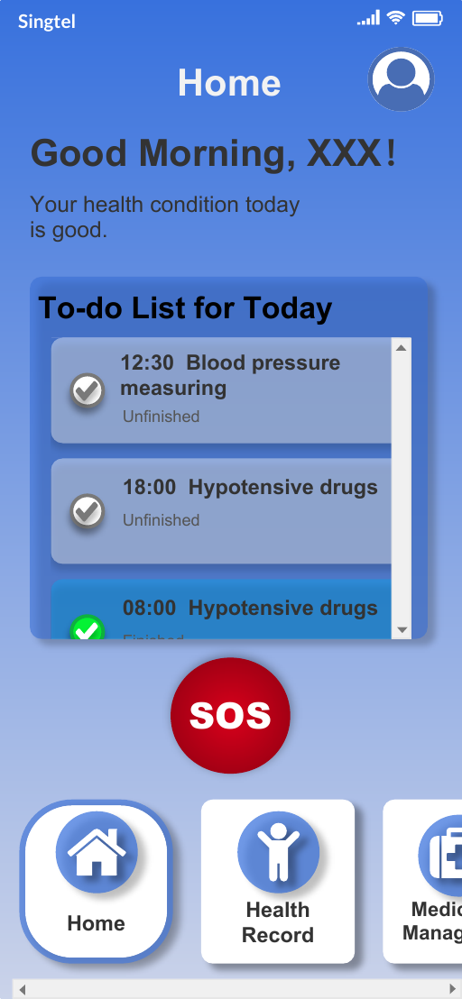
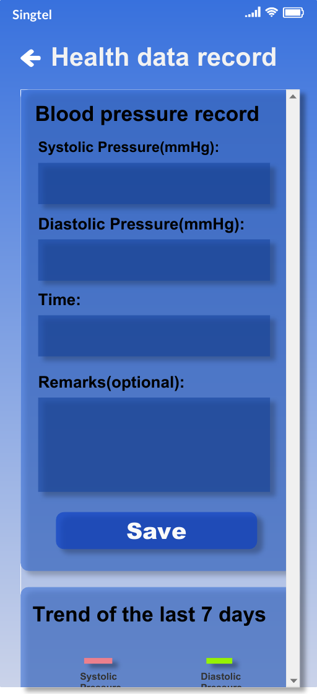
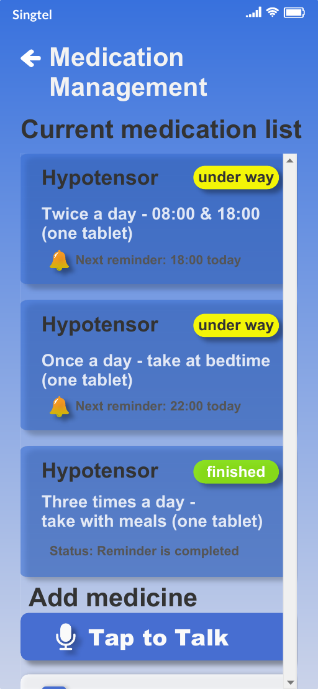
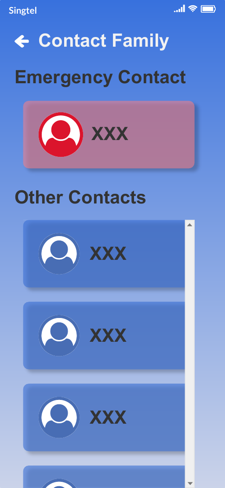

# Elderly Health Care App: Interactive Prototype

A mobile app prototype that helps older adults record blood pressure, stay on top of medication and reach family quickly in an emergency. Designed, specified and prototyped end to end as a solo product design project.

**Live demo:** https://1aoy596.github.io/Elderly-Health-Care-App-Prototype/  
**Case study / slides:** [PASTE LINK HERE]



> **What this is:** a clickable Axure RP prototype, not a production app. Speech recognition, reminders and data are simulated. The interactions (taps, swipes, animations, back navigation) work as specified.

## The problem

Older adults who manage a condition such as high blood pressure have to remember several small tasks every day: measuring, recording, taking the right tablet at the right time, and telling family when something is wrong. My own grandparents live with diabetes and high blood pressure and take medication every day; we do not live together, so looking after them is not always easy. Many health apps use small text, dense screens and a lot of typing.

**Problem statement:** How might we help an older adult keep a daily health routine on track, with as few taps and as little typing as possible, while keeping family within one tap in an emergency?

## Users

| User | Needs |
| --- | --- |
| Older adult (primary) | Simple reminders, readable screens, voice instead of typing, no hunting through contacts |
| Family caregiver (secondary) | Reassurance that medication is taken, fast contact when something is wrong |

## Research

I interviewed 8 older adults aged 75 to 90 (5 family members and 3 residents of my neighbourhood) about how they manage their health today. Four participants then helped test the design with a paper card-sorting exercise: I turned the app's buttons into paper cards and asked each person to arrange them in the positions and order that made sense to them. The sample is small and local, so I treat the findings as early signals, not a representative sample.

| What I observed | Design decision |
| --- | --- |
| The arrangements participants made were very different from the layout I had planned. | Changed the position and the wording of the buttons to follow how participants arranged them |

## Features and priorities

| Feature | Priority | Why |
| --- | --- | --- |
| Medication list with reminders and status | Must have | Missing a dose is the highest-risk failure in the daily routine |
| Voice input for adding medication | Must have | Removes typing, which many older adults cannot do on a phone |
| Blood pressure record and 7-day trend | Must have | Gives the user and family a simple picture of progress |
| SOS button and emergency contact | Must have | Safety feature, always visible on Home; contacts the emergency contacts directly, so older adults do not have to pick from the contacts list, where they often tap the wrong person; the specification defines a long press to avoid accidental calls |
| Today's to-do list on Home | Should have | Puts the day's tasks in one place |
| Contact family (tap to call) | Should have | Fast contact beyond emergencies |
| Doctor appointments, device sync, caregiver view | Later | Needs integrations or a second app, so out of scope for version 1 |

## Key screens

| Home | Health record | Medication | Contact family |
| --- | --- | --- | --- |
|  |  |  |  |

## Main flows to try

1. **Sign in:** open the prototype, tap Login, and you arrive at Home.
2. **Home:** tick a task in the to-do list; it changes to finished and moves to the end. The SOS button is shown here; its long-press call flow is defined in the specification but is not wired in this prototype.
3. **Add medication by voice:** Medication, then Tap to Talk, then follow the three steps (speak, confirm, done).
4. **Record blood pressure:** Health record, enter values, save, and see the 7-day trend.
5. **Call family:** Contact family, then tap a contact.

The behaviour of every control is written down in the interaction specification: [LINK TO SPEC PDF, OPTIONAL].

## Design decisions

- **Voice-first medication entry** with a three-step indicator and a Re-Enter option, because many older adults cannot type on a phone. Manual entry remains as a fallback.
- **SOS always visible on Home.** The specification defines a long press so it cannot be triggered by accident (specified, not implemented in the prototype).
- **One hub:** every screen is one step from Home, and the back arrow always returns the user.

## Limitations and next steps

- Small sample from one community (8 interviewees, 4 testers); I have not measured whether the design improves medication adherence.
- The SOS long-press emergency flow is specified but not implemented in the prototype.
- Known issues: some small labels and touch targets are still below recommended sizes (listed in AUDIT.md), and the bottom navigation needs a swipe to reach every tab. The login hint text was raised to 16px with higher contrast.
- Next: test the interactive prototype with a wider group of older adults and with caregivers, improve contrast and text size, build a working version with a database and real reminders, and add a caregiver view.

## Run locally

```bash
git clone https://github.com/1aoy596/Elderly-Health-Care-App-Prototype.git
cd Elderly-Health-Care-App-Prototype
python3 -m http.server 8000
# open http://localhost:8000 in your browser
```

Serve the folder over HTTP rather than opening the files directly, so the Axure export can load its scripts and assets.

## About this project

- **Role:** sole product owner, UX designer and spec writer
- **Duration:** about two weeks
- **Tools:** Axure RP 9
- **AI assistance:** I used an AI coding assistant (Codex) to tidy the exported HTML and prepare it for hosting, including the contrast fix on the login hint text. The design, interaction logic and specification are my own work.

## Contact

Li Yao · yao987507@163.com · [LinkedIn](https://www.linkedin.com/in/yao-li-40b09129a)
